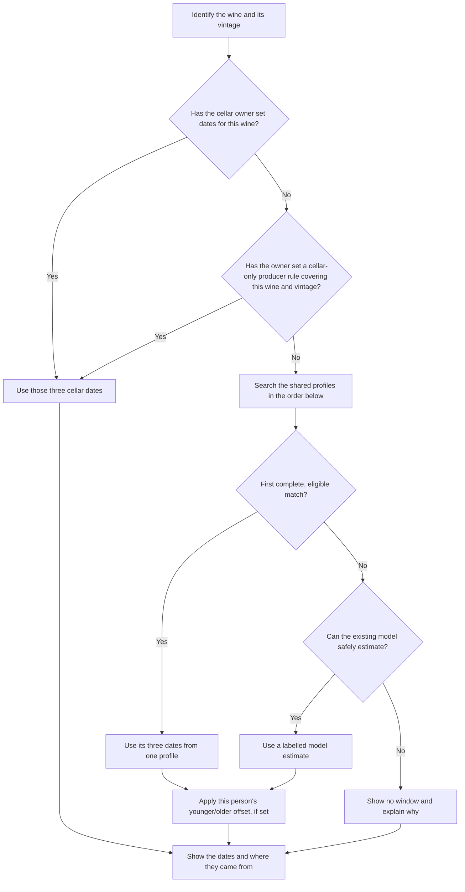
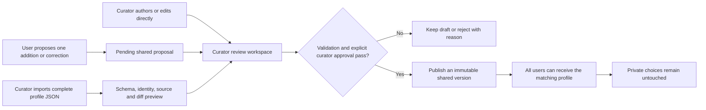
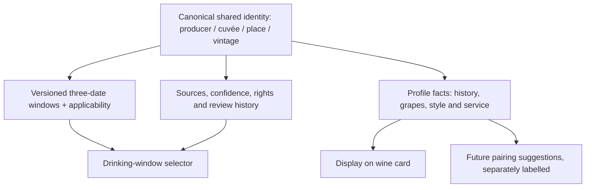

# Drinking windows — product contract and execution plan

**Status: proposed contract for owner confirmation, 29 October 2026.** This is
the single product definition for the drinking-window feature. It records the
owner's requested end state, not a claim that the current application already
does it. The [living release record](drinking-window-release-plan.md) tracks
implementation and deployment. Where older design notes or pilot procedures
conflict with this contract, this contract governs the target; the older text
must be reconciled before general release. A passing PR is not a released
feature.

## 1. What a cellar owner receives

For a wine with a confirmed canonical identity, CellarManager presents **one
coherent three-year window**:

1. Start tasting: the first useful year to open and assess the wine.
2. Probable start of the optimal period.
3. Probable end of the optimal period. This is not an expiry date.

All three years come from **one selected record**. We never take one year from
a producer profile and another from a region or model. We do not infer an
unlisted vintage from a fixed `vintage + N` formula. The card shows the
selected source, exact scope, profile version, explanation, and whether the
dates are source-published or a reviewed editorial estimate.

The shared-profile search stops at the first complete, eligible match:

| Order | Shared source | Required match |
| --- | --- | --- |
| 1 | Exact producer and cuvée | Producer, cuvée, vintage, appellation, region and colour. |
| 2 | Shared producer profile | Same producer, vintage and colour; a curator explicitly stated which wines its general row covers. |
| 3 | Appellation profile | Same appellation, vintage and colour; this wine belongs to the reviewed ageing group. |
| 4 | Region profile | Same region, vintage and colour; this wine belongs to the reviewed ageing group. |

If none matches, the existing model is a **labelled last resort**, not a
shared profile. If it cannot safely estimate a window, the card says so. A
cellar-only producer rule is different from a shared producer profile: the
cellar owner enters their own three years for a stated producer, vintage and
scope of wines; it affects only their cellar. It cannot silently carry over
to another vintage or to every cuvée.

An exact shared row must match the **canonical producer, cuvée, vintage,
appellation, region and colour**. An explicitly
size-specific record must match the bottle size; otherwise size is not used
to invent a different window. Approved aliases can resolve identity, but OCR
text or fuzzy similarity alone cannot authorize a profile match. If identity
is ambiguous or the recorded appellation and region contradict each other,
the app asks for correction instead of guessing. A producer-wide row is only
used when a curator explicitly defined it as applicable; the absence of a
cuvée-specific row does not itself make another row generic.

At appellation and region scope, a reviewed ageing category or an explicit
all-wines applicability statement is required where wines have materially
different ageing styles. Membership is reviewed, not inferred from price,
prestige, or a generic label. Thus a long-ageing Côte du Py row never silently
applies to Les Charmes or every Morgon. A region uses its **own** vintage data;
no fallback copies dates from another region. Colour and vintage remain exact.

### Personal choices and precedence

- Cellar-only three-date values for one wine take precedence over everything.
- A cellar-only producer rule can supply explicit three-date values for a
  stated scope and vintage. It takes precedence over shared profiles but
  never changes them or another cellar.
- A personal younger/older offset shifts **all three years together** after a
  shared or model source has been selected. The card shows the underlying
  dates and the adjusted dates. It does not alter the shared database, and it
  does not silently shift explicit private dates a second time.
- Removing a private choice restores the next applicable source. A later
  shared update never overwrites private choices.

**Confirmed ownership rule (29 October 2026):** explicit wine dates and
cellar-only producer rules belong to a cellar and are editable by its owner,
so they apply to that cellar's members. A general younger/older offset belongs
to an individual account and affects only that person's view. Neither private
choice changes the shared database.

### Concrete selection examples

| Situation | Expected result |
| --- | --- |
| Published Burgaud / Côte du Py / 2022 exact row is 2025 / 2028–2040 | Use that complete row, labelled producer + cuvée + vintage. |
| Same row, personal offset +2 years | Display shared 2025 / 2028–2040 and personal 2027 / 2030–2042; no shared edit. |
| No exact Côte du Py 2022 row, but a reviewed applicable Morgon 2022 group exists | Use the complete Morgon row, labelled appellation estimate. |
| No applicable Morgon row, but a reviewed applicable Beaujolais 2022 group exists | Use the complete Beaujolais row, labelled region estimate. |
| Neither broader group includes this wine | Do not borrow another group's dates; use the labelled model estimate if safe, otherwise no window. |
| The cellar owner entered dates for this wine or a cellar-only Burgaud rule covering it | Use those cellar dates and preserve them through future shared updates. |

## 2. How the shared database changes

Regular users may propose an addition or correction to an individual drinking
window, including a missing vintage. The proposal is visible as **pending**;
it never changes published advice by itself. A user cannot submit an entire
producer/appellation/region profile through the bulk-import interface.

A curator has a specific CellarManager permission. A curator can review and
edit a user proposal, or create/correct a shared window directly. The same
curator **may approve and publish their own reviewed work**; a second curator
is not required. The action is audited with identity, before/after values,
provenance and version. Mandatory validation and a preview of changed wine
advice remain, but routine updates do not require a developer PR, a separate
publisher, or each household owner's approval. An approved version becomes
available across users; private wine/producer choices continue to win.

For a bulk profile import, the curator sees the whole proposed change: new
identities, added/changed/removed vintage rows, unsupported source claims,
conflicts, and affected advice. One explicit batch approval may publish a
validated set; it need not require hundreds of repetitive clicks. Invalid or
unverified rows are quarantined with reasons and cannot be silently
published with the rest. Importing a file is **not** approval. Every published
row retains its source and editorial provenance. Publication is atomic,
versioned and reversible; replacing a profile does not erase its history.

The initial activation may use a pilot cellar to verify the selection engine,
interface and safety controls. That is a **temporary deployment gate**, not
the normal contribution process. Once the feature is generally released,
curator-approved shared updates are available without per-household opt-in.
No user gets a private override rewritten by publication.

## 3. Profiles and exchange format

CellarManager maintains shared producer, appellation and region profiles.
The supplied producer JSON v1.1 files are the first input, not test fixtures
to discard after a pilot. The exchange contract must support complete
producer-profile import, not only extract exact-release date
candidates. A corresponding versioned exchange schema is needed for
appellation and region profiles. A curator can upload and publish those
profiles from the app after the review above; a regular user cannot use the
bulk uploader.

The optional profile facts may include a short producer/place history,
grapes, acidity, sweetness, body, structure, serving advice and direct
pairing guidance. The supplied producer files already contain some cuvée,
structure and pairing fields. Their provenance and scope must be retained.
These facts are not themselves drinking-window dates, and an inferred pairing
must be labelled as such. Rich profile display can follow the date engine,
but the schema and import must not throw those fields away. Pairing inference
is not a gate for the first drinking-window release.

## 4. Execution plan — six gates, at most six PRs through deployment

Each gate has a deliverable and a testable exit condition. The
[living release record](drinking-window-release-plan.md) must show **not
started / in progress / verified / deployed** for each gate, with evidence.
Every PR touching this feature must name the gate it advances, list what is
still missing, and update that record. A merge alone never moves a gate to
**deployed**. A change to this contract requires an explicit decision in the
record; implementation cannot silently redefine the flow.

**Hard PR budget:** existing [PR #227](https://github.com/alexv3429/cellarmanager/pull/227)
is **1/6 (Gate 0)**, not a prelude to six more PRs. Gates 1–5 have one PR
each, slots **2/6–6/6**. A fix found before a gate PR merges goes into that
same PR; a fix found after merge is included in the next gate PR. Gate 5's
slot includes the changes needed for deployment, but its merge alone is not
completion: the official app and database must pass its post-deployment checks.
If this budget cannot safely deliver the contract, stop and ask the owner to
decide what changes; do not silently open a seventh PR or declare success.

| PR slot | Gate | Work to deliver | Exit evidence |
| --- | --- | --- | --- |
| 1/6 · #227 | 0. Lock this contract | Reconcile conflicting older notes and record acceptance cases. The cellar-only producer-rule ownership is confirmed above. | Owner confirms the complete contract; expected results are recorded for Côte du Py, appellation, region, offset and cellar-only choices. Gate 1 turns these into automated tests. |
| 2/6 | 1. Correct the core selection and preferences | Make the published selector follow the exact → applicable broader → model order; apply personal offsets to reviewed dates; add cellar-only producer rules; preserve private wine windows. | Automated precedence, no-mixing, identity, membership, format, colour, vintage, offset and override tests pass; the wine card shows base and effective dates with source. |
| 3/6 | 2. Finish curator and user workflows | User proposes one window; curator directly authors or edits, self-approves and publishes. Replace pilot-only publisher/household approvals as routine requirements while keeping audit, preflight, diff and rollback. | In the app, one user proposes Burgaud 2023; one curator publishes it without another curator, developer PR or household opt-in; a second user sees it and private choices remain unchanged. |
| 4/6 | 3. Import complete profiles | Support whole producer v1.1 files and agreed appellation/region JSON; preview identity mapping and changes; preserve window and optional profile facts with provenance; batch-approve valid rows, quarantine others. | Curator can import and publish a complete profile from the app; re-import/idempotency and malformed/conflicting-file tests pass; no silent partial import. |
| 5/6 | 4. Prepare the initial common base | Process all 23 supplied producer files and the reviewed appellation/region fallbacks in a staging/restored database. Resolve canonical identities and membership; prepare approved rows for publication and report every excluded row with a reason. | A coverage manifest lists each file, row and status; real catalogue fixtures resolve exact, appellation and region matches; no row is assumed publishable because it parsed. |
| 6/6 | 5. Release and verify | Rehearse migrations on a restored backup, deploy code and schema, publish the approved initial base, run a mobile pilot, then enable ordinary shared publication. | Official app shows correct source, dates and private adjustments; user/curator end-to-end test passes; another cellar receives a new approved vintage; emergency-off/rollback work; release record contains build, migration, published-row counts and postflight evidence. |

### Current gap ledger (before work on this contract)

- **Gate 0:** The owner confirmed cellar-wide producer rules and a
  personal offset. This complete contract still awaits review; older
  documentation describes different approval and rollout rules.
- **Gate 1:** Exact/broader reference selection and a private wine window
  exist in prior work, but the existing personal offset explicitly excludes
  reviewed references. Cellar-only producer-rule authoring is absent.
- **Gate 2:** User exact-wine proposals and curator review exist; the proposed
  PR #227 adds more curation tools, but routine publication still depends on
  a separate publisher grant and pilot/household approval.
- **Gate 3:** PR #227 parses producer v1.1 files into compact exact-release
  **research candidates** only. It does not store or publish full profiles,
  optional facts, appellation or region JSON.
- **Gate 4:** The supplied 23-file bundle parses as 670 proposed exact
  releases, but none was imported into the linked database by PR #227 and
  none is declared published by this contract. Eligibility, source fit and
  canonical identity require review.
- **Gate 5:** PR #227 is not a feature release. Its tests are useful evidence
  for its implemented foundation, not proof of the end target above.

**No-surprise rule:** before asking the owner to merge or test, report (a) the
gate and exact behavior now available, (b) what is still absent, (c) whether
database migration or real data changes are involved, (d) the precise test
path/link and expected result, and (e) what owner decision, if any, is needed.
Never say “the feature is ready” while any gate above lacks exit evidence.
